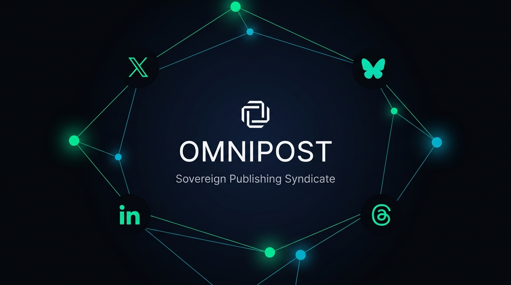
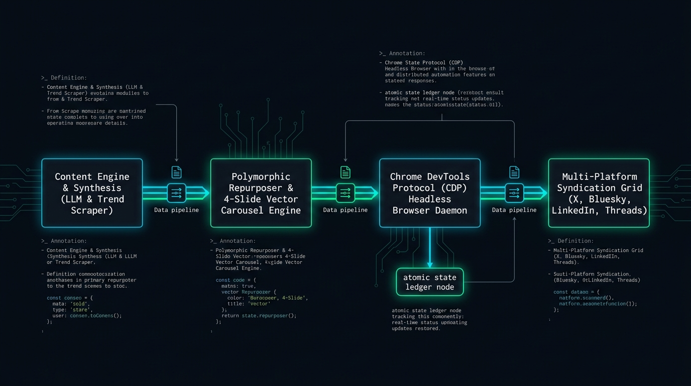
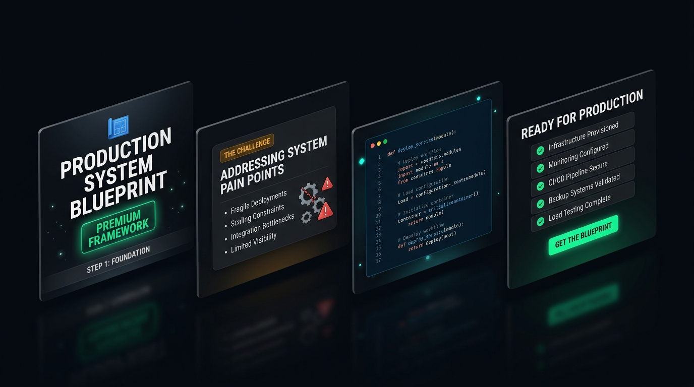

<p align="center">
  
</p>

<p align="center">
  <a href="https://github.com/Lordporus/omnipost/releases"></a>
  <a href="https://python.org"></a>
  <a href="LICENSE"></a>
  <a href="https://github.com/Lordporus/omnipost/actions"></a>
  
  
</p>

<h1 align="center">OmniPost V2.6</h1>

<p align="center">
  <b>Autonomous, Zero-Cost Cross-Platform Publishing Syndicate for AI Agents & Technical Builders.</b><br />
  <i>Simultaneous distribution across X, Bluesky, LinkedIn, and Meta Threads without SaaS fees, recurring API subscriptions, or platform limits.</i>
</p>

---

## What's New in 2.6

This release is about one thing: **a click is not a post.** Every path that used to report success without proof now fails loudly instead.

* **Publishing from a background tab works.** Both X and Threads render a degraded composer when their tab is not active — X puts the editor outside its `[role="dialog"]` shell, Threads lays the modal out at `0×0` and the feed's inline "Post" button wins the click. The tab is now activated before every write, and navigation stays conditional so an already-open tab is not reloaded.
* **X writes are scoped to the composer dialog.** Attach, insert and submit all resolve through the dialog-owned editor, and the body is read back through `COMPOSE_STATE_JS` before Post is clicked. A missing dialog or an empty body raises `SelectorError` instead of typing into the page.
* **Threads must confirm the submit.** After clicking Post, OmniPost waits up to 15 s for the composer to close. An unconfirmed submit is a retryable `failed`, never a terminal `submitted_unverified` — the state that used to leave live posts marked as unverified forever.
* **LinkedIn document uploads go through the real flow.** The content-type button, the anchor control, a full pointer sequence, and a captured file input (`Page.fileChooserOpened`) instead of blocking on the OS dialog.
* **New rehearsal harness.** `scripts/rehearse_composer.py` opens a live composer, attaches media, asserts the attach contract, and dismisses without posting.

---

## The Sovereign Distribution Thesis

Technical founders and autonomous AI agents face a broken distribution reality:

* **The SaaS Tax:** Mainstream social schedulers charge \$50 to \$250/month, yet remain constrained by cloud API rate limits.
* **The Platform API Paywall:** Commercial API access on X starts at \$100/month; LinkedIn partner programs restrict document uploads behind proprietary enterprise audits.
* **Format Fragmentation:** What performs on X (short punchy contrarian hook) fails on LinkedIn (technical case study + document carousel), Bluesky (decentralized ATProto thread), and Meta Threads (conversational builder dialogue).

**OmniPost resolves this through local sovereignty:**
It runs directly on your local workstation, inside a self-contained Docker container, or on a \$5/mo Linux VPS. By automating your own authenticated browser sessions via the **Chrome DevTools Protocol (CDP)** and communicating natively with the **ATProto XRPC protocol**, OmniPost delivers enterprise-grade multi-platform syndication with **\$0 API costs, forever.**

---

## ⚠️ Risks & Limitations (Read Before Running)

Production automation requires complete technical honesty. OmniPost does not hide the realities of browser automation:

> [!WARNING]
> **1. Platform Terms of Service & Account Risk**  
> Automating web browsers on platforms like X (Twitter), LinkedIn, and Meta Threads operates in an adversarial grey zone and violates their automated browsing policies. If detected or reported, **your account can be rate-limited, shadowbanned, or permanently suspended**. Always use accounts you are willing to risk, or stick to Bluesky where ATProto provides official, sanction-free open APIs.

> [!IMPORTANT]
> **2. Account Warm-Up Requirement**  
> New accounts publishing automated technical content at scale look identical to botnet spam operations. **Do not turn on multi-post automation on a fresh account.**  
> * Manually fill out your avatar, bio, and header banner.  
> * Post 3–5 manual thoughts and reply to 2–3 community accounts.  
> * Start automation at **1 post/day** for the first 14 days before ramping to 3–4 daily slots.

> [!CAUTION]
> **3. Vision Model Trust Boundaries**  
> Vision models (GPT-4o, Claude 3.5 Sonnet, Gemini 1.5 Flash) are outstanding for high-level semantic layout checks, verifying image/card rendering, and checking text readability. **Vision is NOT reliable for numbers, exact timestamps, or fine-grained UI badges.** Vision models frequently hallucinate impression counts, misread timestamps, and invent navigation items. OmniPost **never** relies on vision output to verify numbers or update `state.json`.

> [!NOTE]
> **4. DOM Fragility & Selector Drift**  
> Web frontend teams at X, LinkedIn, and Meta continuously deploy A/B tests and change DOM class names and data attributes. While OmniPost isolates failures per platform and logs exact errors, **human maintenance of DOM selectors is inevitable**. When an adapter breaks due to an upstream UI rewrite, update the selector in `adapters/` or check our issue tracker.

> [!IMPORTANT]
> **5. Scope Boundaries: Publishing Only**  
> OmniPost is strictly an **autonomous publishing and syndication engine**. It does not automate replies, direct messages (DMs), likes, or follow/unfollow loops. Automating social interactions is the fastest route to account termination and degrades public discourse.

---

## System Architecture

<p align="center">
  
</p>

OmniPost operates as a deterministic, decoupled four-stage pipeline:

```
┌─────────────────────────────────┐     ┌──────────────────────────────────┐
│  1. RESEARCH & SYNTHESIS        │     │  2. POLYMORPHIC REPURPOSER       │
│  • Hacker News, arXiv, RSS      │ ──> │  • Voice profiling & tone matching│
│  • Local LLM / Cloud Provider   │     │  • 1 Insight ──> 4 Target Shapes  │
└─────────────────────────────────┘     └──────────────────────────────────┘
                 │                                        │
                 ▼                                        ▼
┌─────────────────────────────────┐     ┌──────────────────────────────────┐
│  4. VERIFICATION & ATOMIC LOG   │     │  3. VISUAL ENGINE & CAROUSEL     │
│  • Real-time timeline scraping  │ <── │  • 16:9 Pillow Infocards (PNG)   │
│  • Activity URN confirmation    │     │  • 4-Slide Vector PDF Carousels  │
│  • Atomic write to state.json   │     │  • Chrome CDP Page.printToPDF    │
└─────────────────────────────────┘     └──────────────────────────────────┘
```

1. **Intelligence & Synthesis Engine (`scripts/generate.py`):** Automatically ingests technical signals from Hacker News, arXiv, and curated RSS feeds. Synthesizes a high-signal topic via your configured LLM (Gemini, Claude, OpenAI, OpenRouter, or zero-cost local heuristics).
2. **Polymorphic Adaptation (`scripts/repurpose.py`):** Dynamically reshapes one core concept into four platform-native payload formats, each within its own measured character band.
3. **Alive Tech Visual Engine (`render/`):** Generates high-density, multi-page vector PDF carousels directly inside headless Chromium over CDP sockets — eliminating fragile C-dependencies (Cairo, Pango, WeasyPrint).
4. **Headless Browser Daemon & Dispatcher (`scripts/browser_daemon.py`, `scripts/autoposter.py`):** Orchestrates stealth browser tabs and ATProto sessions, publishes payloads, and validates live URL/URN status before updating the atomic state ledger.

---

## Repository Map

```
omnipost/
├── adapters/          # One class per platform. All implement base.py's
│                      #   publish() / verify() / check_session() contract.
├── scripts/           # CLI entry points: pipeline, publish, schedule,
│                      #   browser daemon, ledger, doctor, onboarding.
├── render/            # Pillow infocards + CDP vector PDF carousels.
├── tests/             # 51 suites, 362 tests, runs on Win/Linux x Py 3.10-3.12.
├── docs/              # Architecture images and design notes.
├── systemd/           # omnipost.service unit for the VPS deploy.
├── examples/          # Scheduling recipes.
└── references/        # Voice profile (local only — gitignored).
```

The adapter contract is the seam that matters. `adapters/base.py` defines four methods; adding a platform means writing one class, not touching the pipeline:

```python
platform_name()  -> str                  # "x", "bluesky", "linkedin", "threads"
capabilities()   -> dict                 # limits, media types, features
check_session()  -> bool                 # is the stored session still valid?
publish(...)     -> PublishResult        # do it
verify(...)      -> bool                 # prove it happened
```

---

## 4-Platform Capabilities Matrix

| Platform | Channel Driver | Visual Format | Verification Mechanism | Operating Cost |
| :--- | :--- | :--- | :--- | :---: |
| **X (Twitter)** | Stealth Chrome CDP Session | 16:9 Infocard (`.png`) | Profile timeline scrape + tweet URL parse | **\$0.00** |
| **Bluesky** | Native ATProto XRPC | 16:9 Infocard (`.png`) | Microsecond commit response + CID/URI | **\$0.00** |
| **LinkedIn** | ProseMirror DOM Automation | 4-Slide Vector PDF Carousel | In-page toast URN (`urn:li:activity`) + feed fallback | **\$0.00** |
| **Meta Threads** | Headless Chrome CDP Session | 16:9 Infocard (`.png`) | Composer-close confirmation + profile permalink scrape | **\$0.00** |

---

## Visual Engine: The 4-Slide "Alive Tech" Carousel

<p align="center">
  
</p>

OmniPost ships an in-house visual engine engineered for maximum engagement and visual authority on LinkedIn.

* **Strict 4-Slide Progression:**
  * **Slide 1 (Hero Hook):** High-impact typographic headline, category pill, and author badge.
  * **Slide 2 (The Problem Space):** Context narrative panel with cyber amber accent badges and friction bullets.
  * **Slide 3 (Core Architecture):** Syntax-highlighted technical code block with cyan accents.
  * **Slide 4 (Production Checklist & CTA):** Actionable takeaways with emerald SVG checkmarks and sovereign outro banner.
* **"Alive Tech" Design System:** Obsidian Black (`#06090E`), Deep Navy (`#121927`), Signal Emerald (`#00F59B`), and Cyber Amber (`#F59E0B`).
* **Zero Duplication Guarantee:** The content parser (`parse_linkedin_payload`) strips raw composite markdown and eliminates redundant headline repetitions across slides.
* **Headless CDP Vector PDF:** Rendered via `Page.printToPDF` at native 1080×1080 resolution (11.25" square at 96 DPI).

```bash
# Render HTML preview and vector PDF from today's draft:
python -m render.carousel

# Generate local HTML proofing preview only:
python -m render.carousel --preview-only
```

---

## Quickstart & Setup

> All commands below use `python`. On Windows, `py -3.12` works identically.

### 1. 1-Click Zero-Friction Bootstrap (Recommended)

OmniPost includes single-click bootstrap scripts that inspect Python, install dependencies from `requirements.txt`, and launch the onboarding ceremony:

```bash
git clone https://github.com/Lordporus/omnipost.git
cd omnipost

# Windows
.\setup.bat

# Linux / macOS
bash setup.sh
```

### 2. Interactive Onboarding Ceremony

The onboarding wizard guides you through credentials, platform channels, and LLM configuration with real-time pre-flight verification:

```
╔═══════════════════════════════════════════════════════════════════╗
║                      OMNIPOST V2.6 ONBOARDING                     ║
║         Autonomous Sovereign Multi-Platform Distribution          ║
╚═══════════════════════════════════════════════════════════════════╝

[1/6] Account Credentials & Handles (X, Bluesky, LinkedIn, Threads)
[2/6] Multi-LLM Provider & Model Selection:
      • Google Gemini (Default: gemini-2.5-flash or custom model)
      • OpenAI (Default: gpt-4o-mini or custom model)
      • Anthropic Claude (Default: claude-3-5-sonnet-20241022 or custom model)
      • OpenRouter (Default: meta-llama/llama-3.3-70b-instruct or custom model)
      ↳ Pre-flight zero-token probe validation... [OK - Verified]
[3/6] Content Strategy & Voice Profile Configuration
[4/6] System Timezone Detection (Auto: Asia/Kolkata)
[5/6] Remote Webhook Alerting (Telegram Bot / Discord Embeds)
      ↳ Live Telegram bot ping test... [OK - "400: chat not found" prevented]
[6/6] Operating Mode (Dry-Run vs Autonomous Live Dispatch)

[SETUP] Configuration sealed to config.json & .env. Ready for production.
```

### 3. Automated / Non-Interactive CI Mode

For CI/CD runners, Docker builds, or automated server provisioning:

```bash
python setup.py --non-interactive
```

---

## Deployment Modes

### Mode A: Local Workstation (Windows / macOS)

Ideal for developers running background automation alongside their daily workflow.

```bash
# 1. Verify runtime readiness
python scripts/prereq_check.py

# 2. Run the daily pipeline: harvest, draft, render
python scripts/pipeline.py

# 3. Test execution safely without posting live
python scripts/autoposter.py --dry-run

# 4. Install the automated background runner (Windows, every 15 mins)
powershell -ExecutionPolicy Bypass -File scripts/setup_scheduler.ps1
```

### Mode B: Docker Container Stack

Fully isolated container packaged with Python 3.12-slim, Chromium, and an Xvfb virtual display.

```bash
# Start the background publishing daemon
docker compose up -d

# Inspect live logs and health status
docker compose logs -f
docker compose ps
```

* **Collision Guard:** `docker-entrypoint.sh` protects against directory-bind mount collisions on clean clones.
* **Persistent Sessions:** Browser profiles and cookies persist in the `omnipost_browser_data` Docker volume.

### Mode C: 1-Click Headless Linux VPS (Ubuntu 22.04 / 24.04)

Deploy onto any \$5/mo cloud server (DigitalOcean, Hetzner, Linode, AWS EC2):

```bash
sudo bash scripts/deploy_vps.sh
```

This single command:

1. Installs system packages (`chromium-browser`, `xvfb`, `fonts-liberation`, `python3-venv`).
2. Clones and configures `/opt/omnipost`.
3. Runs non-interactive onboarding and guarantees state ledger files.
4. Registers and starts `omnipost.service` using a non-blocking background Xvfb runner.

```bash
# Check service status
sudo systemctl status omnipost
sudo journalctl -u omnipost -f
```

---

## Remote Webhook Monitoring & Executive Summary Cards

OmniPost delivers instant executive notifications via Telegram Bot API and Discord Webhooks:

* **Executive Drop Summary Cards:** Upon batch publication, delivers a formatted summary featuring platform status badges (`✅ X`, `✅ Bluesky`, `✅ Threads`, `✅ LinkedIn`), direct clickable post permalinks, account handles, and execution latency.
* **Amber Network Timeout Alerts:** If transient network packet loss occurs during a post attempt, OmniPost emits a non-fatal amber warning and proceeds to remaining platforms without hanging.
* **Session Expiration Guard:** Fast-fail alerts immediately dispatched if browser cookies expire, preventing silent pipeline stalls.

---

## Command Reference

### Setup & diagnostics

| Command | Description |
| :--- | :--- |
| `.\setup.bat` | 1-click Windows bootstrap: installs requirements, starts onboarding. |
| `bash setup.sh` | 1-click Linux/macOS bootstrap: installs requirements, starts onboarding. |
| `python setup.py` | Interactive onboarding ceremony with live credential and model validation. |
| `python setup.py --non-interactive` | Headless setup for VPS and container provisioning. |
| `python scripts/prereq_check.py` | Validates Python, Git, browser, Docker, and ports. |
| `python scripts/doctor.py --healthcheck` | Fast healthcheck, exit code 0/1, for orchestrators. |
| `python scripts/doctor.py --live` | Deep diagnostic: network feeds, browser CDP, platform sessions. |

### Content generation

| Command | Description |
| :--- | :--- |
| `python scripts/pipeline.py` | Harvest, generate 4 native drafts, render visuals. |
| `python scripts/pipeline.py --date 2026-10-31 --force` | Regenerate a specific day, overwriting existing slots. |
| `python -m render.carousel` | Compile the 1080×1080 HTML preview and vector PDF. |
| `python -m render.carousel --preview-only` | HTML proofing preview only, no PDF. |

### Publishing

| Command | Description |
| :--- | :--- |
| `python scripts/publish_now.py --text "..."` | Uniform text to every target. Must satisfy each platform's limits. |
| `python scripts/publish_now.py --draft drafts/2026-10-31.json` | Platform-native texts from a daily draft. |
| `python scripts/publish_now.py --draft drafts/2026-10-31.json --slot 13:00` | One specific slot from that draft. |
| `python scripts/publish_now.py --draft '<json>'` | Inline JSON with per-platform texts. |
| `--platforms x,threads` | Restrict the run. Default is every enabled platform. |
| `--fresh` / `--force-fresh` | Harvest and generate today's draft before publishing. |
| `--timeout 120` | Per-platform worker budget in seconds (default 150: X spends ~25s publishing plus up to 90s waiting for a stale timeline to refresh). |
| `--force` | Override an existing idempotency reservation. |
| `--retry-failed` | Retry `failed` records. Never retries `submitted_unverified`. |
| `--verify-content` | Validate draft copy against platform limits without posting or opening a browser. |
| `--dry-run` | Simulate without sending. |
| `python scripts/autoposter.py` | Publish the currently due slot, if any. |
| `python scripts/autoposter.py --dry-run` | Evaluate the due slot without posting. |
| `python scripts/autoposter.py --live --timeout 120` | Override `dry_run` for this run. |
| `python scripts/daemon.py` | Long-running supervisor: 11:00 pipeline, 5-minute publish checks. |
| `python scripts/daemon.py --once` | Single iteration, for cron-driven containers. |

### Scheduling & maintenance

| Command | Description |
| :--- | :--- |
| `python scripts/gate.py` | Print `IDLE` (byte-identical) when no slot is due. Costs nothing. |
| `python scripts/due.py check` | Same gate, JSON output, for cron monitors. |
| `python scripts/due.py show` | Print today's plan and its jittered slots. |
| `python scripts/rehearse_composer.py --platform threads --media shot.png` | Open a live composer, attach media, assert the attach contract, dismiss. No post. |

### Exit codes (`publish_now.py`)

| Code | Meaning |
| :---: | :--- |
| `0` | Every target is `published_verified`. |
| `1` | At least one target failed. |
| `2` | Connectivity offline; publishing deferred. |
| `3` | Dispatch finished, but at least one target is `submitted_unverified`. |

---

## Reliability Contract: Fail Closed, Never Guess

Every publish stage either proves success or records a failure it can retry. There is no "probably posted".

| Stage | Fails when | Ledger status | Retryable |
| :--- | :--- | :--- | :---: |
| Composer open | Page never hydrates within 30 s | `failed` | ✅ |
| Composer layout | Modal lays out at `0×0` | `failed` | ✅ |
| Body insert | Read-back does not match the intended text | `failed` | ✅ |
| Submit click | No Post button inside the composer subtree | `failed` | ✅ |
| Submit confirmation | Composer still open after 15 s | `failed` | ✅ |
| Readback | Permalink not found on the profile | `submitted_unverified` | ❌ terminal |

`submitted_unverified` is deliberately terminal: the post may or may not exist, so a retry risks a duplicate. Reconcile it by hand, not by re-running.

---

## Architectural Guarantees & Fault Tolerance

1. **Partial-Failure Isolation:** If LinkedIn triggers a rate limit or cooldown, successful posts on X, Bluesky, and Threads are recorded immediately. Only failed channels are queued for subsequent retry intervals.
2. **Crash-Safe Atomic Ledger:** `state.json` updates use atomic filesystem replacement with a journal across the Docker bind mount. Corrupted JSON states are impossible even during sudden reboots or parallel cron runs.
3. **Browser Auto-Healer:** `scripts/browser_daemon.py` monitors port 9444 and respawns headless Chrome with appropriate sandbox flags (`--no-sandbox`, `--disable-dev-shm-usage`) if the browser terminates.
4. **Zero Vendor Lock-In:** All credentials, cookies, and local database ledgers reside exclusively on your machine.

---

## 🛠️ Pitfalls Already Paid For (11 Hard-Won Lessons)

Do not relearn these in production the hard way:

1. **Background Tab = Broken Composer:** A tab that is not active renders a degraded SPA. X puts the editor outside `[role="dialog"]` and the dialog shell comes back empty; Threads lays the modal out at `0×0`, so the first Post button in DOM order is the feed's inline one and nothing gets submitted. Activate the tab before every write, and scope the submit to the composer that owns the editor.
2. **CDP WebSocket Drops:** Creating a CDP target on `about:blank` and navigating to heavy web apps (like X or Reddit) drops the WebSocket (`no close frame received or sent`). Always create targets pointing directly to the final destination URL.
3. **ProseMirror & React Synthetic Events:** Setting `.value = ...` or `innerText = ...` does not fire framework events. React and ProseMirror composers stay empty and the submit button remains disabled forever. Use CDP `Input.insertText`.
4. **A Click Is Not a Post:** Clicking Post and moving on produces live posts recorded as unverified. Require the composer to close (or the permalink to appear) before writing success to the ledger.
5. **Stealth Evasion Detection:** Launching Chrome with `--remote-debugging-port` leaks automation flags (`navigator.webdriver == true`). OmniPost injects stealth masking scripts before DOM instantiation.
6. **Stale Timeline Rendering:** Social feeds cache aggressively. Reading an author's profile immediately after posting often shows an older cached feed. Poll profile readback over 30–90 seconds before concluding a post is missing.
7. **PDF Carousel Viewport Scaling:** Headless `Page.printToPDF` clips or blurs slides unless the page styling locks `@page { size: 1080px 1080px; margin: 0; }` with precise DPI paper dimensions (11.25" square at 96 DPI).
8. **LinkedIn Rate Limit Cooldown Windows:** Disagreeing with LinkedIn's internal velocity algorithms triggers immediate temporary account locks. Enforce a minimum 4-hour gap between consecutive posts.
9. **Atomic Ledger State Locks:** Naive file writes corrupt JSON during crashes or parallel cron executions, and Docker bind mounts return `EBUSY` on rename. OmniPost journals to PID-tagged files, then does an in-place fsync write.
10. **Zero-Cost Idle Suppression (`scripts/gate.py`):** Un-gated cron scripts that wake LLM agents every 10 minutes waste hundreds of dollars in idle tokens. The gate emits byte-identical `IDLE\n` when no slot is due, suppressing agent invocations until work exists.
11. **The Voice Drift Trap:** Autonomous generation drifts into sycophantic corporate cheerleading ("Delighted to share...", "What are your thoughts?"). OmniPost anchors every draft to an empirically measured voice profile with an enforceable "DO-NOT" list.

---

## 📦 Minimal Dependencies Philosophy (4 Runtime Dependencies)

Sovereign software must be easy to run anywhere without dependency hell:

| Package | Version | Why it is here |
| :--- | :--- | :--- |
| `websockets` | `>= 12.0` | Talks directly to Chrome/Edge over CDP. No Selenium, Playwright, or Puppeteer. |
| `Pillow` | `>= 10.0.0` | Renders 16:9 infographic cards locally. No Cairo, Pango, or ImageMagick. |
| `pyyaml` | `>= 6.0` | Parses and validates Docker Compose and stack configuration. |
| `requests` | `>= 2.28.0` | HTTP helper for research feeds and webhook delivery. |

**Total runtime dependencies: 4.** Everything else is the standard library (`urllib`, `json`, `sqlite3`, `pathlib`, `hashlib`, `subprocess`).

Dev-only: `pytest`, `pytest-asyncio`, `beautifulsoup4`.

* **Cost of adding a new platform adapter:** 0 additional dependencies.
* **Risk of installation failure across Windows, Linux, and macOS:** Negligible.

---

## Test Suite & Verification

362 tests across 51 suites. The suite runs on Linux and Windows against Python 3.10, 3.11, and 3.12 in CI.

```bash
python -m pytest -q
```

```
362 passed, 3 warnings in 66.25s
```

### What is covered

| Area | Suites | What it pins |
| :--- | :--- | :--- |
| **Adapter contracts** | `test_adapter_contracts`, `test_adapters`, `test_selector_contracts` | Every adapter implements the base contract; selectors stay in sync with the JS. |
| **X** | `test_x_dialog_scope`, `test_x_media_guard` | Dialog-scoped writes, body read-back, fail-closed media. |
| **Threads** | `test_threads`, `test_threads_hydration` | Hydration wait, `0×0` guard, submit confirmation, permalink scope. |
| **LinkedIn** | `test_linkedin`, `test_linkedin_carousel`, `test_linkedin_document_trigger` | ProseMirror writes, carousel payloads, document upload flow. |
| **Bluesky** | `test_bluesky` | ATProto XRPC session, blob upload, facets. |
| **Reliability** | `test_idempotency`, `test_retry_isolation`, `test_state_truth`, `test_state_journal`, `test_post_state_transaction`, `test_media_fail_closed`, `test_warmup_status` | Idempotency reservations, ledger truth, crash-safe writes, fail-closed media. |
| **Content** | `test_content_integrity`, `test_platform_limits`, `test_guardrails`, `test_validator`, `test_repurposer` | Character bands per platform, guardrails, source traceability. |
| **Rendering** | `test_infocard`, `test_carousel`, `test_carousel_rendering`, `test_storybook_render` | PNG infocards, vector PDF carousels. |
| **Infra** | `test_docker_config`, `test_vps_deployment`, `test_browser_daemon`, `test_browser_remote`, `test_prereq_check` | Compose spec, systemd unit, CDP daemon, remote host translation. |
| **E2E** | `test_integration_e2e`, `test_overhaul_e2e`, `test_multi_platform`, `test_pipeline` | Full pipeline runs with mocked adapters. |

### The CI contract job

A second CI step runs the suites that must never regress silently:

```bash
python -m pytest tests/test_selector_contracts.py tests/test_artifact_privacy.py \
                 tests/test_storybook_render.py tests/test_carousel_rendering.py -q
```

### Manual rehearsal against the live SPA

Mocks cannot catch a layout change. When a composer breaks, rehearse against the real site — it opens the composer, attaches media, asserts the attach contract, and dismisses without posting:

```bash
python scripts/rehearse_composer.py --platform threads --media shots/card.png
python scripts/rehearse_composer.py --platform x --media shots/card.png
```

---

## Contributing & Development

Contributions to adapters, rendering styles, or scheduling algorithms are welcome.

1. Fork the repository.
2. Create your feature branch (`git checkout -b feat/new-platform-adapter`).
3. Ensure all tests pass (`python -m pytest`).
4. Commit your changes (`git commit -m "feat(adapter): add Mastodon CDP/API support"`).
5. Open a Pull Request.

New adapter checklist: implement the four methods in `adapters/base.py`, add a selector-contract suite, and add a row to the capabilities matrix above.

---

## License

OmniPost is open-source software licensed under the [MIT License](LICENSE).
